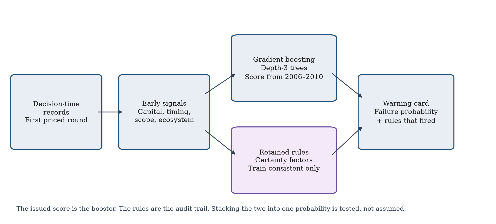
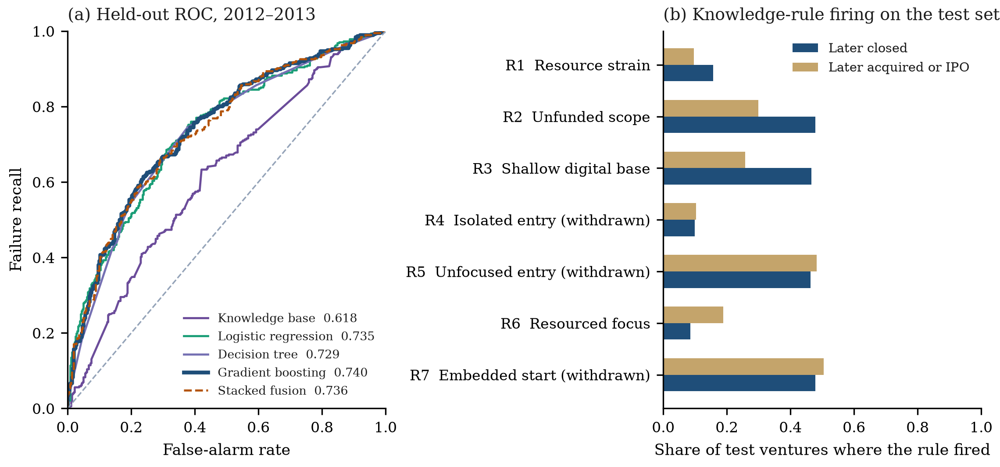

# A knowledge-based early-warning system for entrepreneurial failure during digital transformation

Short Communication

Hemasri Babburu  
Doctor of Business Administration candidate

## Abstract

Screening a digital venture at its first priced round is a different problem from explaining, after the fact, how much capital it raised. Totals, later rounds, and the date of the last round keep moving until the firm closes, so a model that uses them partly rediscovers the outcome. This Short Communication presents KB-EWS, a knowledge-based early-warning system that scores closure from signals available at that first round and attaches the certainty-factor rules that fired. Seven rules were written before estimation. A rule is kept only when, on ventures first funded in 2006–2010, its mean strength is at least 0.02 higher in the class it was written to support. Four rules survive. On 737 digitally oriented ventures first funded in 2012–2013, the pre-specified depth-3 gradient booster reached a ROC area of 0.740 (95% bootstrap interval 0.704–0.776). Reviewing the highest-scoring 30% gave precision 0.760 (0.706–0.824) against a base rate of 0.510 and recovered 44.7% of later closures. Paired tests do not separate the booster from logistic regression (ROC-area difference 0.005, p = 0.61). The retained rules alone reached 0.618. Stacking their certainty factor onto the booster lowered the ROC area by 0.004 (p = 0.045). KB-EWS is the implemented warning tool. Under a fixed review budget it returns a closure probability and the rules whose strength reached 0.5, so a person can both rank the queue and see the mechanism. That is the decision-support claim. It is not a causal estimate of a digital-transformation program, and the rules do not replace the statistical rank.

Keywords: knowledge-based systems; intelligent decision support; prediction and warning systems; knowledge engineering; artificial intelligence; data-driven prediction; digital transformation; entrepreneurship; certainty factors

## 1. Introduction

Closure, a change of ownership, and insolvency are different events, and survival studies often mix them [1]. For a digital venture the screening decision arrives at the first priced financing, not at the post-mortem. Digital entrepreneurship builds the offer, the channel, and the operating system together [2], and digital transformation renews the business model over time rather than in a single installation [3,4]. A warning that uses the last round cannot serve that decision.

Credit scoring has a long early-warning tradition that uses only what is known when the decision is made [5]. Venture classifiers often leave it. Cumulative capital, the round count, and the recency of the last round are larger because the firm lived long enough to raise again, and they stop when it dies. Crunchbase-style extracts are common in management research and carry known limits of coverage and outcome coding [6]. Without a fixed decision time they reward hindsight.

Reviewers also speak in rules. A thin first round together with a broad category list is a different statement from a one-unit change in log capital. Certainty factors were built so a short rule base could accumulate graded evidence and stay readable [7]. KB-EWS places that rule base beside a statistical score and then tests, on a later year, whether merging the two improves ranking.

The contribution is threefold: (i) a decision-time formulation that admits only first-round signals and refuses lifetime funding fields in code; (ii) a seven-rule certainty-factor layer whose retention test withdraws any rule that points against its own mechanism on the training years; and (iii) a year-split benchmark with baselines, a fixed review budget, paired bootstrap tests, and a stacking test that is allowed to fail. The last item is part of the result. A warning system has to show when the rules should stay on the card and out of the probability.

The human decision is which first-round ventures to review. KB-EWS supports that prediction with two computed fields: a calibrated probability that ranks a fixed share of the cohort, and the retained production rules whose strength reached 0.5. Knowledge engineering is the retention step. The business setting is the first priced round. The machine-learning layer supplies the rank. The experiment decides which layer is allowed to move the decision.

## 2. Proposed KB-EWS framework

### 2.1 Decision time, cohort, and label

The decision time is the earliest funding round with a positive disclosed amount. A venture enters if one of its categories is in a fixed digital lexicon (software, mobile, e-commerce, analytics, cloud, and the related labels in the program), both dates parse, and the first priced round falls within ten years of founding.

The signal vector holds the log first-round amount, the log of one plus days from founding, the category count, digital depth (the share of categories in the lexicon), the log of one plus a trailing ecosystem count, round type, and country. The ecosystem count is the number of other digital ventures in the same region first funded in the previous three calendar years, excluding the focal year. Country uses the eight most common training countries, with the United States as the reference. Round type uses a venture round as the reference. Total capital, lifetime round count, last-round date, and status are banned. The program stops if any of them enters the design matrix.

The label is 1 when the recorded status is closed and 0 when it is acquired or an initial public offering. Ventures still operating on the export date are dropped. Some acquisitions are distress sales; the file does not say which [1]. The label is closure versus a recorded exit among ventures that had reached one of those states.

### 2.2 Knowledge-rule layer

Conditions are memberships on [0, 1]. For a low concept with cuts ℓ < h,

μ_low(x) = clip((h − x) / (h − ℓ), 0, 1). (1)

A high concept ramps the other way. Rule strength is the fuzzy conjunction

s_r = min_j μ_j. (2)

Training-year cuts, fixed before the test years are read, are as follows. Thin capital ramps from the 25th to the 60th percentile of log first-round amount, about $475,000 to $2.8 million. Slow funding ramps from the 40th to the 75th percentile of log days since founding, about 314 to 1,088 days. Broad scope ramps from 2 to 4 categories. Thin ecosystem ramps from about 11 to about 98 earlier peers in the region. Shallow digital depth uses the band 0.40–0.80, and deep digital depth uses 0.50–0.90. The complementary memberships define adequate capital, timely funding, narrow scope, and a dense ecosystem.

Seven rules were specified with fixed certainty factors c_r. Evidence e_r = c_r s_r is pooled by the Shortliffe–Buchanan rule [7], inputs clipped to [−0.99, 0.99], in the order R1 to R7:

CF(a, b) = a + b(1 − a) if both are non-negative, a + b(1 + a) if both are non-positive, and (a + b) / (1 − min(|a|, |b|)) otherwise. (3)

The implementation checks CF(0.50, 0.40) = 0.70 and CF(−0.20, −0.30) = −0.44.

The rules are: R1 resource strain (c = +0.55), thin capital and slow funding; R2 unfunded scope (+0.45), thin capital and broad scope; R3 shallow digital base (+0.35), thin capital and shallow digital depth; R4 isolated entry (+0.30), thin ecosystem and slow funding; R5 unfocused entry (+0.25), broad scope and shallow digital depth; R6 resourced focus (−0.50), adequate capital, narrow scope, and deep digital depth; R7 embedded start (−0.30), dense ecosystem and timely funding. A positive factor is evidence for later closure.

Retention uses 2006–2010 only. A rule is kept when its mean strength is at least 0.02 higher in the class named by its sign. R1, R2, R3, and R6 meet that bar (training means 0.132 versus 0.096, 0.282 versus 0.158, 0.322 versus 0.168, and, for the protective rule R6, higher among exits). R4 and R5 are stronger among exits, which is the wrong direction for a closure rule, and are withdrawn. R7 differs by less than 0.02 and is withdrawn. The retained base is therefore R1–R3 and R6.

### 2.3 Score, calibration, and stacking

Logistic regression, a tree of depth at most 4 with at least 40 ventures per leaf, and a histogram gradient booster are fit on 2006–2010 [8]. The booster uses depth 3, learning rate 0.06, an L2 penalty of 0.1, balanced class weights, and early stopping on an internal 15% of the training years, which selected 84 trees. The 2011 year does not grow the trees. Logistic regression and the tree also use balanced class weights. Logistic regression is scaled with a scaler fit on the training years.

Each score, including the retained certainty factor, is mapped to a probability by a one-variable logistic fit on 2011 [9]. Stacked fusion is a further logistic regression on that same year,

η = β0 + β1 logit(p_boost) + β2 CF, (4)

with the booster probability clipped away from 0 and 1. The coefficient on CF is free. The pre-specified issued probability is the calibrated booster. Equation (4) asks whether the audit trail should also move the probability.

Algorithm 1. KB-EWS

Input: company file, round file, digital lexicon, year split 2006–2010 / 2011 / 2012–2013
Output: for each test venture, a closure probability and the retained rules that fired

1: Form the first priced round. Exclude total capital, lifetime round count, last-round date, and status.
2: Keep digital ventures funded within ten years of founding. Compute the trailing ecosystem from earlier years only.
3: Label closure against acquisition or IPO. Drop ventures still operating.
4: Fit the membership cuts on 2006–2010. Retain R1–R7 only when the training direction agrees by at least 0.02.
5: Fit logistic regression, the tree, and the depth-3 booster on 2006–2010.
6: Fit a Platt map for each score on 2011, and fit Eq. (4) on 2011.
7: On 2012–2013, issue the calibrated booster probability and every retained rule with strength at least 0.5.
8: Evaluate precision and recall inside pre-set review budgets of 20% and 30%. Do not choose the budget on the test labels.

### 2.4 What the reviewer receives

The system is the program `kbews.py`. For each of the 737 ventures first funded in 2012–2013 it writes one row of `outputs/warning_cards.csv`. The two fields a reviewer would see are the calibrated closure probability and the retained rules whose strength reached 0.5. Ranking those probabilities and reviewing the highest-scoring 30% is the action. Section 4 tests that action. It also tests the alternative in which the certainty factor is allowed to change the probability. That alternative is rejected for ranking. The card still shows the rules, because the reviewer’s question is which mechanism fired as well as where the venture sits in the queue. The file stores the later closure beside the card so the action can be checked. That label is not an input, and it would not be on the card at the first round.

## 3. Experimental design

The source is the Crunchbase export of 4 December 2015, redistributed as CSV by Tripp (notpeter/crunchbase-data, commit be8711fd) under CC BY-NC 4.0. Commercial use of the extract requires a Crunchbase licence. The code downloads the files when it runs and does not store them in the repository.

Of 66,368 companies and 114,949 rounds, 53,583 have a priced first round and 28,482 also match the lexicon. Dates and the ten-year window leave 21,407 ventures; 4,290 of them had a resolved status. The analysis sample is the 3,150 resolved ventures first funded in 2006–2013: 1,901 for training (closure share 0.426), 512 for 2011 (0.525), and 737 for test (0.510, of which 376 closed). Median first-round size is $1.65 million in training and $750,000 on the test years.

The five systems in Table 1 share those test ventures. Uncertainty for a single system is a 1,000-draw bootstrap interval. Paired differences use 2,000 matched draws. The two-sided p-value is twice the smaller tail around zero. If no draw changes sign, p is reported as <0.001. The seed is 7. Figure 1 is the decision path. Figure 2 is the held-out ranking and the precision of a review budget from 10% to 50%.

## 4. Results and discussion

**Table 1.** Held-out comparison on 737 ventures first funded in 2012–2013. Intervals are 95% bootstrap percentiles. The 30% budget reviews the 221 highest scores. Lower Brier is better.

| System | ROC-AUC | PR-AUC | Brier | Precision at 30% | Recall at 30% |
|---|---:|---:|---:|---:|---:|
| Retained knowledge base | 0.618 (0.576–0.657) | 0.601 | 0.242 | 0.633 (0.575–0.701) | 0.372 |
| Logistic regression | 0.735 (0.698–0.771) | 0.743 | 0.209 | 0.751 (0.692–0.810) | 0.441 |
| Decision tree | 0.729 (0.691–0.764) | 0.702 | 0.212 | 0.751 (0.697–0.810) | 0.441 |
| Gradient boosting | 0.740 (0.704–0.776) | 0.745 | 0.207 | 0.760 (0.706–0.824) | 0.447 |
| Stacked fusion | 0.736 (0.699–0.771) | 0.743 | 0.208 | 0.769 (0.715–0.828) | 0.452 |

**Table 2.** Paired bootstrap tests of the depth-3 booster minus the named alternative, on the same 737 ventures. Positive values favour the booster.

| Comparison | Metric | Difference | 95% interval | p |
|---|---|---:|---:|---:|
| Booster vs knowledge base | ROC-AUC | +0.122 | 0.078 to 0.166 | <0.001 |
| Booster vs knowledge base | Precision at 30% | +0.127 | 0.063 to 0.195 | <0.001 |
| Booster vs logistic regression | ROC-AUC | +0.005 | −0.012 to 0.022 | 0.61 |
| Booster vs logistic regression | Precision at 30% | +0.009 | −0.027 to 0.059 | 0.55 |
| Booster vs decision tree | ROC-AUC | +0.011 | −0.009 to 0.031 | 0.28 |
| Booster vs decision tree | Precision at 30% | +0.009 | −0.032 to 0.063 | 0.61 |
| Booster vs stacked fusion | ROC-AUC | +0.004 | 0.0001 to 0.008 | 0.045 |
| Booster vs stacked fusion | Precision at 30% | −0.009 | −0.023 to 0.014 | 0.76 |

The booster’s top 30% contains 168 of 376 closures. Precision 0.760 is 1.49 times the test base rate of 0.510. That is a usable screen. It is not evidence that the booster beats a linear model. Table 2 puts the ROC gap against logistic regression at 0.005 (p = 0.61) and the precision gap at 0.009 (p = 0.55). The tree is likewise inside the noise (p = 0.28 and p = 0.61). Most of the separable signal is linear in the early signals. The depth-3 booster remains the pre-specified score because that choice was made before the test year was read. Figure 2 shows why a single operating point is not the whole story: at a 10% budget, logistic precision is 0.892 and the booster’s is 0.865; by 30% the curves have met; by 50% all four statistical scores sit near 0.69–0.70, still above the base rate and above the rule base.

The knowledge base is the part a reviewer can read, and it is not the ranker. Its ROC area of 0.618 is above chance, and the paired gap to the booster is 0.122 (p < 0.001). On the test years, which were not used to keep or drop rules, R2 fired for 47.9% of later closures and 29.9% of exits. R3 fired for 46.5% and 25.8%. R6, the protective rule, fired for 8.5% of closures and 18.8% of exits. R1 fired for 15.7% and 9.7%. The withdrawn rules do not separate the test outcomes in the direction originally written. Raising the retention margin from 0.02 to 0.05 drops R1 and moves the rule-base ROC area from 0.618 to 0.608. A margin of 0.00 retains the same four rules as 0.02. The primary rule set is not an artefact of a knife-edge threshold.

The class-balanced training regression shows why conjunctions and main effects are not the same statement. One standard deviation more log first-round amount lowers closure log-odds by 0.511, and one standard deviation more log ecosystem size lowers them by 0.328. Angel and seed rounds, relative to a venture round, raise log-odds by 0.333 and 0.163. A longer wait for the first round lowers closure log-odds by 0.276 per standard deviation, and a longer category list lowers them by 0.154, while digital depth raises them by 0.132. R1 survives only as the conjunction of a small round and a long wait. R2 and R3 survive because thin capital, not breadth or depth alone, is doing the work. Round type, which the rules do not encode, is one reason the rule base lags the regression.

Stacked fusion estimates β1 = 1.034 on the booster logit and β2 = −0.233 on the certainty factor (intercept −0.128). Once the booster is known, a higher failure certainty factor slightly lowers the stacked probability. The ROC area falls by 0.004 (p = 0.045). Precision at 30% moves from 0.760 to 0.769, and that difference is compatible with noise (p = 0.76). The rules stay on the warning card. They do not enter the issued probability.

The two fields on the card are the decision-support result. The statistical layer ranks ventures inside a human review budget. The knowledge layer names which retained mechanism crossed 0.5. Explainability is that fired rule and its certainty factor. Stacking the rule into the probability does not improve the rank the reviewer would act on.

## 5. Limitations

The association is not an effect of a digital-transformation program. The export records categories, a first round, and a later status. It does not record a transformation project inside the firm. Operating ventures are omitted, so 0.510 is not a population failure rate. Some acquisitions are failures under another name. Categories can be edited after founding. Ecosystem counts rise across the decade, and the test years sit in denser regions than the training years (median peers 59, then 124, then 156). The score uses only the first round. A later warning could be sharper and would answer a different question.

The booster was chosen as the primary score before the paired tests were read. Those tests then showed that logistic regression matches it. Reporting the booster as if it had won a significant comparison would overstate Table 2. The benchmark is one public extract with a December 2015 horizon. A second geography, a later extract, or a round-level file that supports a true survival time would be a different study. The retention margin of 0.02 was set as a small practical gap, and the sensitivity above is the check on that choice.

## 6. Conclusion

KB-EWS is a warning system for the first priced round. It returns a calibrated closure probability and the retained certainty-factor rules that fired, and a fixed budget turns that probability into a review queue. On ventures first funded in 2012–2013, the top 30% of booster scores concentrate later closures from a base rate of 0.510 to a precision of 0.760. A logistic regression reaches the same standard, so either score can drive the queue. The rule base documents four mechanisms and does not match that rank. Stacking the rules into the probability does not improve the queue.

The system supports a human screening decision with an inspectable rule layer and a tested statistical rank. It is not a causal model of digital transformation, and it is not a substitute for information that arrives after the first round.

## Data availability

Running `python kbews.py` rebuilds the cohort, the retention decision, the five scores, the warning cards, Table 1, Table 2, and both figures from the public export and a fixed seed. The numeric source for the tables is `outputs/metrics.json`. The per-venture cards are `outputs/warning_cards.csv`. The raw Crunchbase files are downloaded into a local cache and are not part of the repository.

## Declaration of competing interest

The author declares that there are no known competing financial interests or personal relationships that could have appeared to influence the work reported in this manuscript.

## Declaration of generative AI and AI-assisted technologies

During preparation of this manuscript, AI-assisted tools were used for language drafting, editing, organization, and formatting support. The author reviewed and edited the content and takes full responsibility for the final manuscript. The experimental data, tables, and figures were generated from executable code.

## Funding

This research received no specific grant from any funding agency in the public, commercial, or not-for-profit sectors.

## CRediT authorship contribution statement

Hemasri Babburu: Conceptualization, Methodology, Software, Validation, Formal analysis, Investigation, Data curation, Writing – original draft, Writing – review and editing, Visualization.

## References

[1] M.A. Josefy, J.S. Harrison, D.G. Sirmon, C. Matz Carnes, Living and dying: synthesizing the literature on firm survival and failure across stages of development, Academy of Management Annals 11 (2) (2017) 770–799. https://doi.org/10.5465/annals.2015.0148

[2] S. Nambisan, Digital entrepreneurship: toward a digital technology perspective of entrepreneurship, Entrepreneurship Theory and Practice 41 (6) (2017) 1029–1055. https://doi.org/10.1111/etap.12254

[3] G. Vial, Understanding digital transformation: a review and a research agenda, Journal of Strategic Information Systems 28 (2) (2019) 118–144. https://doi.org/10.1016/j.jsis.2019.01.003

[4] K.S.R. Warner, M. Wäger, Building dynamic capabilities for digital transformation: an ongoing process of strategic renewal, Long Range Planning 52 (3) (2019) 326–349. https://doi.org/10.1016/j.lrp.2018.12.001

[5] E.I. Altman, Financial ratios, discriminant analysis and the prediction of corporate bankruptcy, Journal of Finance 23 (4) (1968) 589–609. https://doi.org/10.1111/j.1540-6261.1968.tb00843.x

[6] J.-M. Dalle, M. den Besten, C. Menon, Using Crunchbase for economic and managerial research, OECD Science, Technology and Industry Working Papers 2017/08 (2017). https://doi.org/10.1787/6c418d60-en

[7] E.H. Shortliffe, B.G. Buchanan, A model of inexact reasoning in medicine, Mathematical Biosciences 23 (3–4) (1975) 351–379. https://doi.org/10.1016/0025-5564(75)90047-4

[8] J.H. Friedman, Greedy function approximation: a gradient boosting machine, Annals of Statistics 29 (5) (2001) 1189–1232. https://doi.org/10.1214/aos/1013203451

[9] J.C. Platt, Probabilistic outputs for support vector machines and comparisons to regularized likelihood methods, in: A.J. Smola, P. Bartlett, B. Schölkopf, D. Schuurmans (Eds.), Advances in Large Margin Classifiers, MIT Press, Cambridge, MA, 1999, pp. 61–74.

## Figures

**Figure 1.** KB-EWS at the first priced round. The issued probability is the depth-3 booster calibrated on 2011. Retained certainty-factor rules are attached when their strength reaches 0.5. Stacking the two into one probability is estimated and then tested; Section 4 shows that it does not improve the held-out rank.

**Figure 2.** Test ventures first funded in 2012–2013 (n = 737). (a) ROC curves. The solid navy curve is the pre-specified score. (b) Precision when a fixed share of ventures is reviewed. The dotted line is the test base rate, 0.510. At a 10% budget the logistic regression is the sharpest screen; at 30% it meets the booster.

